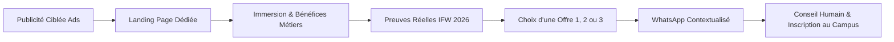

# CAHIER DES CHARGES & ARCHITECTURE TECHNIQUE & ARTISTIQUE
## PROJET : LANDING PAGES HAUTE FIDÉLITÉ — IFAM BÉNIN

> **Statut :** Validé pour production  
> **Auteur :** Creative Technologist, Art Director & Lead Frontend Engineer  
> **Marque :** IFAM BÉNIN  
> **Cible de trafic :** Publicités Meta Ads / TikTok Ads / Campagnes directes  

---

## 1. VISION STRATÉGIQUE & OBJECTIFS COMMERCIAUX

### 1.1 Contexte et Objectif
IFAM BÉNIN (Institut de Formation aux Métiers de la Mode) est l'institution de référence au Bénin dans l'apprentissage professionnalisant de la couture, du stylisme et du modélisme.  
L'objectif de ce projet est de concevoir **deux landing pages indépendantes, immersives et cinématographiques** :
1. `/stylisme-modelisme` : orientée vers les profils créatifs et futurs directeurs artistiques souhaitant créer des collections de A à Z.
2. `/modelisme` : orientée vers les profils techniques, tailleurs et artisans souhaitant maîtriser le patronage, la coupe et la confection de précision (homme et dame).

Chaque page est spécialement conçue pour recevoir du trafic publicitaire froid et tiède. Chaque section répond à une objection réelle, met en valeur les preuves concrètes de l'école et guide avec élégance le prospect vers **un échange humain sur WhatsApp** pour finaliser son orientation.

### 1.2 Le Tunnel de Conversion Direct-Response


---

## 2. DIRECTION ARTISTIQUE & EXPÉRIENCE SENSORIELLE HAUTE COUTURE

### 2.1 L'Atmosphère de Marque
L'expérience visuelle s'inspire des codes des maisons de couture internationales tout en honorant l'ancrage béninois et le dynamisme de la jeunesse créative locale.  
- **Esthétique :** Contraste fort entre le noir ébène profond d'atelier et la blancheur soyeuse de l'étoffe, dynamisé par l'éclat du **fuchsia signature** et les repères dorés du **mètre ruban de couturier**.
- **Matière :** Lignes de repères fines évoquant le papier patron, surpiqûres subtiles, micro-animations au scroll sans surcharge, typographie taillée avec rigueur.

### 2.2 Système Chromatique & Design Tokens
```css
:root {
  /* Couleurs Fondatrices IFAM */
  --ifam-fuchsia: #E4007C;
  --ifam-fuchsia-hover: #C5006B;
  --ifam-fuchsia-glow: rgba(228, 0, 124, 0.25);
  --ifam-jaune-or: #FFC72C;
  --ifam-jaune-gold: #E5A800;
  
  /* Nuances Atelier & Contrastes */
  --ifam-noir-profond: #0B0B0E;
  --ifam-noir-surface: #141419;
  --ifam-noir-card: #1B1B22;
  --ifam-blanc-pur: #FFFFFF;
  --ifam-blanc-soie: #F9F9FB;
  --ifam-gris-bordure: #2D2D38;
  --ifam-gris-craie: #E5E5EB;
  --ifam-texte-mute: #9CA3AF;

  /* Typographie */
  --font-serif-couture: 'Playfair Display', Georgia, serif;
  --font-sans-technique: 'Plus Jakarta Sans', system-ui, sans-serif;
}
```

### 2.3 Typographie
- **Titres (Headings) :** *Playfair Display* — Apporte l'élégance statutaire, le prestige des revues de haute couture et la noblesse du métier.
- **Corps de texte & Composants UI :** *Plus Jakarta Sans* — Apporte une lisibilité immédiate, une rigueur géométrique et un confort de lecture optimal sur écran mobile.

---

## 3. ARCHITECTURE TECHNIQUE & ARBORESCENCE DU PROJET

### 3.1 Structure des Répertoires
```text
IFAM BENIN LANDING PAGE/
├── index.html                      # Page portail / aiguillage élégant vers les 2 formations
├── stylisme-modelisme/
│   └── index.html                  # Landing Page dédiée Stylisme-Modélisme
├── modelisme/
│   └── index.html                  # Landing Page dédiée Modélisme
├── css/
│   ├── base.css                    # Design tokens, reset, typographies, utilitaires
│   ├── components.css              # Boutons, cartes, navbar, badges, accordéons, modals
│   └── landing.css                 # Mises en page sections, hero, carrousels, animations
├── js/
│   ├── main.js                     # Logique globale, menu mobile, observer d'animations
│   ├── whatsapp.js                 # Générateur de liens contextualisés et tracking clicks
│   └── campus-selector.js          # Sélecteur dynamique des 8 campus avec repères
├── assets/
│   ├── images/                     # Photos réelles optimisées d'ateliers et de la soutenance
│   │   ├── logo-ifam-officiel.jpg
│   │   ├── atelier-machine-apprenantes.jpeg
│   │   ├── atelier-table-coupe-groupe.jpeg
│   │   ├── atelier-patronnage-formatrice.jpeg
│   │   ├── cours-dessin-stylisme-croquis.jpeg
│   │   ├── cours-creation-patron-dos.jpeg
│   │   ├── couture-machine-piquage.jpeg
│   │   ├── atelier-prise-de-mesures-conception.jpeg
│   │   ├── atelier-finitions-couture.jpeg
│   │   ├── soutenance-robe-princesse.jpeg
│   │   ├── soutenance-robe-sirene-perles.jpeg
│   │   ├── soutenance-robe-voile-dentelle.jpeg
│   │   ├── soutenance-robe-mariee-volant.jpeg
│   │   ├── soutenance-haute-couture-duo.jpeg
│   │   ├── soutenance-haute-couture-trio.jpeg
│   │   └── soutenance-haute-couture-quatuor.jpeg
│   └── videos/
│       ├── video-immersion-atelier.mp4
│       └── video-ambiance-cours.mp4
└── docs/
    ├── referentiel-donnees.md      # Source de vérité des données
    ├── cahier-des-charges-architecture.md # Ce document
    └── suivi-des-taches.md         # Tracker de projet
```

### 3.2 Standards de Développement Lead Frontend
- **Zéro Framework lourd inutile :** HTML5 sémantique pur, CSS3 natif avec Grid/Flexbox, JavaScript vanilla moderne (ES6+).
- **Vitesse de chargement maximale :** Temps de chargement inférieur à 1,5 seconde sur mobile en 4G. Lazy-loading natif des images réelles.
- **Responsive Parfait :** Conçu d'abord pour smartphone (vue 375px à 430px), puis tablette et desktop (vue jusqu'à 1440px).
- **Garantie Zéro Prix :** Vérification automatisée qu'aucun chiffre de prix n'apparaît dans le balisage, les métadonnées, les attributs JSON-LD ou les commentaires.

---

## 4. DÉCOUPAGE SECTION PAR SECTION DES DEUX PAGES

### 4.1 Page 1 : `/stylisme-modelisme` (Durée : 18 mois + 6 mois de stage)

| # | Section | Objectif Commercial & UX | Éléments & Contenu Spécifique |
| :- | :--- | :--- | :--- |
| **01** | **Top Bar & Navigation** | Rassurer immédiatement sur le statut officiel et le contact direct. | Logo officiel IFAM BÉNIN, numéro affiché `+229 01 91 55 30 30`, bouton rapide WhatsApp direct. |
| **02** | **Hero Section Haute Couture** | Capter l'attention en 3 secondes, qualifier le prospect, susciter l'aspiration créative. | **Badge :** « Formation Professionnelle d'Élite au Bénin ». <br>**Titre H1 :** *De l'esquisse à la haute couture : devenez Styliste-Modéliste accompli(e).* <br>**Accroche :** « L'excellence au cœur de la formation. Maîtrisez le dessin de mode, la coupe sur-mesure et lancez votre propre marque. » <br>**CTA Primaire :** « Discuter de mon projet sur WhatsApp ». <br>**Badge Réassurance :** Cursus complet 18 mois + 6 mois de stage en entreprise. |
| **03** | **Bandeau de Chiffres & Crédibilité** | Poser l'autorité sans faux chiffres : baser la crédibilité sur des faits réels. | 8 Campus au Bénin • 80% de Pratique en Atelier • Soutenance Publique IFW • Matériel Professionnel. |
| **04** | **Le Double Métier : Créer & Réaliser** | Clarifier la différence et la puissance d'un profil complet Styliste ET Modéliste. | Explication contrastée : Le Styliste imagine, dessine et définit les tendances ; le Modéliste donne vie au croquis par le patronage de précision et l'assemblage. |
| **05** | **Immersion Ateliers & Gestes Métiers** | Prouver la réalité des équipements et de l'encadrement en atelier. | Galerie photos réelles d'apprenants en uniforme IFAM : croquis de mode, coupe à la grande table, piquage mécanique, finitions soignées. |
| **06** | **Programme Détaillé des 24 Mois** | Structurer la progression de l'apprenant pour lever l'inconnu. | - Phase 1 : Dessin de mode, proportions du corps et culture textile.<br>- Phase 2 : Patronnage à plat, moulage sur mannequin et coupe.<br>- Phase 3 : Confection haute précision, flou et tailleur.<br>- Phase 4 : Leadership, gestion d'atelier et entrepreneuriat.<br>- Phase 5 : 6 mois de stage professionnel en immersion + Défilé de soutenance IFW. |
| **07** | **La Preuve Par l'Excellence : Soutenance IFW 2026** | Démontrer le niveau d'aboutissement des étudiants sans faux témoignages. | Présentation des créations réelles présentées devant jury : robes de mariée royales brodées, créations de gala en tissu damassé bleu et blanc. |
| **08** | **Les 3 Formules d'Accompagnement (Sans Prix)** | Permettre au visiteur de choisir le niveau d'équipement qui lui convient. | **Offre 1 (Pack Équipement & Mentorat)** : Machine à coudre incluse + 2 T-shirts + 12m tissu + Mentorat Bénin & France + Accompagnement entrepreneuriat.<br>**Offre 2 (Pack Ateliers & Pratique)** : Fer à repasser + 1 T-shirt + 2 ateliers spécialisés + 6m tissu + Cursus intégral.<br>**Offre 3 (Cursus Académique Intégral)** : Formation complète 18 mois + 6 mois de stage.<br>*CTA sur chaque offre menant vers WhatsApp avec message pré-rempli ciblé.* |
| **09** | **Les 8 Campus Proches de Chez Vous** | Lever l'objection géographique en montrant la proximité. | Carte interactive & fiches détaillées des 8 sites : Cotonou, Calavi (2 sites), Porto-Novo, Parakou, Cococodji, Bohicon, Akpakpa. |
| **10** | **FAQ Stratégique & Réassurance** | Lever les dernières hésitations avant le passage à l'action. | Faut-il savoir dessiner au départ ? Est-ce adapté aux débutants ? Quel est le rythme des cours ? Comment fonctionne le stage ? |
| **11** | **Bandeau de Clôture & Footer Institutionnel** | Dernier appel à l'action chaleureux et pérenne. | Rappel du slogan, formulaire de contact WhatsApp instantané, téléphone officiel, copyright. |

---

### 4.2 Page 2 : `/modelisme` (Durée : 1 an / 12 mois)

| # | Section | Objectif Commercial & UX | Éléments & Contenu Spécifique |
| :- | :--- | :--- | :--- |
| **01** | **Top Bar & Navigation** | Uniformité de l'autorité IFAM BÉNIN. | Logo officiel, numéro `+229 01 91 55 30 30`, contact WhatsApp direct. |
| **02** | **Hero Section Rigueur & Précision** | Focaliser sur la maîtrise technique du patronage et de la confection. | **Badge :** « Formation Technique Intensive — 1 An ». <br>**Titre H1 :** *Maîtrisez l'art de la coupe parfaite et du vêtement sur-mesure.* <br>**Accroche :** « L'excellence au cœur de la formation. Apprenez à transformer n'importe quel modèle en patron impeccable pour homme et dame. » <br>**CTA Primaire :** « Être conseillé(e) sur WhatsApp ». <br>**Sous-titre :** 12 mois de pratique intensive pour devenir un modéliste autonome. |
| **03** | **Bandeau de Clarté & Rigueur** | Clarification immédiate du métier. | **Avertissement bienveillant :** « Le Modélisme est la science architecturale du vêtement (patronnage, coupe, montage) — distinct du mannequinat. » |
| **04** | **Les Compétences Enseignées** | Démontrer l'utilité pratique immédiate. | Prise de mensurations exacte, tracé des bases (corsage, jupe, pantalon, veste), gradation, transformation de modèles complexes, montage à la machine. |
| **05** | **Double Maîtrise : Homme & Dames** | Un atout commercial majeur souligné dans l'offre officielle. | Formation couvrant la couture masculine (chemises, pantalons, tuniques traditionnelles de cérémonie) et féminine (robes structurées, tailleurs). |
| **06** | **Preuves en Atelier Réel** | Valider la méthodologie IFAM. | Photos réelles des ateliers : apprenants à la table de coupe, prise de repères au millimètre, travail sur machine industrielle. |
| **07** | **Les 3 Formules Modélisme (Sans Prix)** | Donner le choix du matériel d'apprentissage. | **Offre 1** : Machine à coudre incluse + 2 T-shirts IFAM + Cours vestiaire Homme & Dames + Leadership & Entrepreneuriat.<br>**Offre 2** : 6 mètres de tissu + Cours vestiaire Homme & Dame + Entrepreneuriat.<br>**Offre 3** : Formation complète en Modélisme (1 an).<br>*Boutons vers WhatsApp personnalisés.* |
| **08** | **Les 8 Campus au Bénin** | Guide géographique clair avec adresses exactes. | Visualisation par région (Littoral, Atlantique, Ouémé, Zou, Borgou). |
| **09** | **FAQ Technique** | Rassurer sur l'accessibilité de la formation. | Peut-on apprendre en 1 an sans expérience ? Pourquoi se former au modélisme aujourd'hui ? |
| **10** | **Footer Officiel** | Identité et coordonnées certifiées. | Identité complète, lien WhatsApp direct, téléphone affiché. |

---

## 5. MATRICE DÉTAILLÉE DES LIENS WHATSAPP AVEC MESSAGES PRÉ-REMPLIS

Afin d'assurer un suivi commercial fluide et sans friction pour l'équipe d'admission d'IFAM BÉNIN, chaque bouton d'action comportera un message pré-rempli ciblé encodé proprement (`encodeURIComponent`) :

| Emplacement / Bouton | Page | Message WhatsApp Pré-rempli |
| :--- | :--- | :--- |
| **Header CTA Rapide** | Stylisme-Modélisme | `Bonjour IFAM BÉNIN, je souhaite me renseigner sur la formation en Stylisme-Modélisme.` |
| **Hero CTA Principal** | Stylisme-Modélisme | `Bonjour IFAM BÉNIN, je souhaite être orienté(e) pour intégrer la formation Stylisme-Modélisme (18 mois + stage).` |
| **Offre 1 (Machine incluse)** | Stylisme-Modélisme | `Bonjour IFAM BÉNIN, je suis intéressé(e) par l'Offre 1 avec machine à coudre en Stylisme-Modélisme. Pouvez-vous m'indiquer les modalités d'inscription ?` |
| **Offre 2 (Pack Ateliers)** | Stylisme-Modélisme | `Bonjour IFAM BÉNIN, je souhaite avoir les informations pour l'Offre 2 en Stylisme-Modélisme.` |
| **Offre 3 (Cursus Intégral)** | Stylisme-Modélisme | `Bonjour IFAM BÉNIN, je souhaite m'inscrire au cursus intégral (Offre 3) en Stylisme-Modélisme.` |
| **Sélection Campus** | Stylisme-Modélisme | `Bonjour IFAM BÉNIN, j'aimerais visiter votre campus de [Nom du Campus] pour la formation Stylisme-Modélisme.` |
| **Header CTA Rapide** | Modélisme | `Bonjour IFAM BÉNIN, je souhaite me renseigner sur la formation intensive en Modélisme (1 an).` |
| **Hero CTA Principal** | Modélisme | `Bonjour IFAM BÉNIN, je souhaite être orienté(e) pour intégrer la formation en Modélisme (1 an).` |
| **Offre 1 (Machine incluse)** | Modélisme | `Bonjour IFAM BÉNIN, je suis intéressé(e) par l'Offre 1 avec machine à coudre pour la formation Modélisme (Homme & Dames).` |
| **Offre 2 (Pack Tissu)** | Modélisme | `Bonjour IFAM BÉNIN, je souhaite des renseignements sur l'Offre 2 pour la formation Modélisme.` |
| **Offre 3 (Cursus Technique)** | Modélisme | `Bonjour IFAM BÉNIN, je souhaite m'inscrire à la formation complète en Modélisme (Offre 3).` |
| **Sélection Campus** | Modélisme | `Bonjour IFAM BÉNIN, j'aimerais avoir des détails sur les cours de Modélisme au campus de [Nom du Campus].` |

---

## 6. PROTOCOLE DE CONFORMITÉ & RÈGLES STRICTES

Avant toute mise en production future, chaque page devra franchir les points de contrôle suivants :

1. **Zéro Prix Public :** Test automatisé regex `grep -iE "([0-9]+\s*(000|cfa|fcfa|f cfa|€|\$))"` certifiant l'absence totale de tarif.
2. **Zéro Acompte 50% :** Aucune mention de pourcentage ou de versement préliminaire.
3. **Zéro GDIZ :** Zéro occurrence dans l'ensemble du code et des textes.
4. **Zéro Fausse Urgence :** Zéro timer ou décompte arbitraire.
5. **Authenticité des Visuels :** 100% des photographies utilisées correspondent aux étudiants, ateliers et défilés réels d'IFAM BÉNIN.
6. **Accessibilité & Rapidité :** Validation Lighthouse Performance > 90 et conformité mobile absolue.
