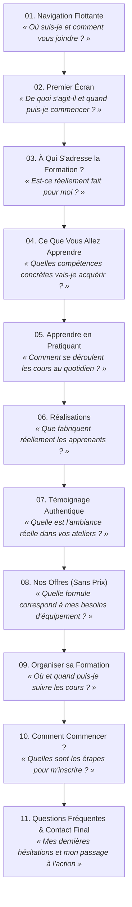

# STRUCTURE DÉTAILLÉE ET RÉDACTION COMPLÈTE DES CONTENUS
## PROJET LANDING PAGES HAUTE FIDÉLITÉ — IFAM BÉNIN

> **Filières couvertes :** `/stylisme-modelisme` et `/modelisme`  
> **Rentrée académique :** 26 octobre 2026  
> **Contacts officiels :** Téléphone affiché : `+229 01 91 55 30 30` | WhatsApp : `2290191553030`  
> **Conformité stricte :** 100 % pratique, diplôme reconnu par l'État, zéro prix publié, zéro 50 %, zéro GDIZ, zéro faux avis/décompte.  

---

# PARTIE I : ARCHITECTURE COMMUNE ET OBJECTIF DE CHAQUE SECTION

Les deux pages partagent une architecture homogène en 11 blocs stratégiques. Chaque section répond à une question précise de l'internaute et lève une objection pour fluidifier la prise de contact WhatsApp.



---

## DÉTAIL DES 11 SECTIONS ET LEUR RÔLE CONVERSATIONNEL

### 1. Navigation Flottante
* **Question du visiteur :** *« Est-ce bien l'école officielle IFAM et puis-je vous joindre rapidement ? »*
* **Rôle UX :** Repère d'autorité immédiat. Navigation par ancres fluides (`#formation`, `#realisations`, `#offres`).
* **Bouton d'action :** Bouton WhatsApp contrasté (« WhatsApp direct »).
* **Mobile :** Barre compacte avec logo officiel, bouton WhatsApp iconographique et menu accessible.
* **Sticky mobile bar :** Bouton flottant discret en bas d'écran (« Échanger sur WhatsApp »).

### 2. Premier Écran (Hero Section)
* **Question du visiteur :** *« Quelle est cette formation, combien de temps dure-t-elle et quand débute la rentrée ? »*
* **Rôle UX :** Accroche cinématographique, qualification immédiate du prospect publicitaire, présentation claire de la filière.
* **Repères clés visibles :** Rentrée le 26 octobre 2026, durée exacte, label 100 % pratique, diplôme reconnu par l'État.
* **Bouton principal :** « Parler de mon projet sur WhatsApp ».
* **Lien secondaire :** « Découvrir le programme » (défilement doux vers la section compétences).

### 3. À Qui S'adresse la Formation ?
* **Question du visiteur :** *« Suis-je au bon endroit si je n'ai jamais touché une aiguille, ou au contraire si j'ai déjà de l'expérience ? »*
* **Rôle UX :** Lever le syndrome de l'imposteur chez le débutant et valoriser le perfectionnement du professionnel sans fausse promesse.
* **Composant UI :** 3 cartes compactes avec volets dépliables (accordéons fluides) :
  1. *Carte A : Débutants complets & Personnes en reconversion*
  2. *Carte B : Autodidactes & Passionnés de mode*
  3. *Carte C : Couturiers en exercice & Porteurs de projet de marque / atelier*

### 4. Ce Que Vous Allez Apprendre
* **Question du visiteur :** *« Quelles compétences précises vais-je maîtriser de mes propres mains ? »*
* **Rôle UX :** Démonstration concrète de l'utilité du programme. Chaque compétence est reliée à un livrable tangible (croquis, patron, vêtement fini).
* **Structure :** 3 axes de compétences majeurs fondés sur le référentiel de cours.

### 5. Apprendre en Pratiquant
* **Question du visiteur :** *« Est-ce une formation théorique ou vais-je réellement confectionner en atelier ? »*
* **Rôle UX :** Rassurer sur la méthode d'apprentissage par le geste.
* **Preuves :** Photographies réelles d'étudiants en blouse/uniforme IFAM à la table de coupe et aux machines.
* **Repères institutionnels :** « Formation 100 % pratique » et « Diplôme reconnu par l'État ».

### 6. Réalisations (Galerie Éditoriale)
* **Question du visiteur :** *« Quel est le niveau réel de finition atteint par les élèves à la fin de leur cursus ? »*
* **Rôle UX :** Preuve irréfutable par le résultat visible (pièces réelles de la soutenance IFW 2026).
* **Composant :** Galerie éditoriale de 4 créations variées (robes de gala, robes de mariée de haute technicité, vestiaire masculin traditionnel brodé, tailleur dame).
* **Fonctionnalité :** Agrandissement plein écran au clic (Lightbox native) pour observer la précision des coutures et des finitions.

### 7. Témoignage Authentique
* **Question du visiteur :** *« Quelle est l'ambiance de travail dans vos ateliers ? »*
* **Rôle UX :** Immersion vidéo sincère, captée in situ dans les ateliers IFAM.
* **Règle éthique :** Pas de citation inventée ni de nom fictif. Lecture vidéo contrôlée au clic.

### 8. Nos Offres (Sans Aucun Prix)
* **Question du visiteur :** *« Quelles formules sont proposées et quel matériel est fourni ? »*
* **Rôle UX :** Présentation honnête des trois niveaux d'accompagnement matériel.
* **Règle absolue :** Zéro prix publié. La formation est complète dans chaque offre (l'Offre 3 comprend l'intégralité du cursus).
* **Bouton d'action spécifique :** « Me renseigner sur cette offre » avec message WhatsApp pré-rempli sur mesure.

### 9. Organiser sa Formation
* **Question du visiteur :** *« Où sont situés vos centres et quels sont les horaires ? »*
* **Rôle UX :** Lever l'objection géographique en montrant l'implantation locale.
* **Contenu :** Rentrée le 26 octobre 2026, créneaux habituels (confirmés lors de l'orientation), et répertoire dépliable des 8 campus au Bénin avec repères routiers exacts.

### 10. Comment Commencer ?
* **Question du visiteur :** *« Que dois-je faire concrètement aujourd'hui pour sécuriser ma place ? »*
* **Rôle UX :** Parcours rassurant en 3 étapes claires :
  1. *Étape 1 : Parler de son projet sur WhatsApp.*
  2. *Étape 2 : Choisir sa formation, son offre et son centre avec l'équipe.*
  3. *Étape 3 : Compléter les formalités d'inscription au campus.*

### 11. Questions Fréquentes & Contact Final
* **Question du visiteur :** *« Qu'en est-il du matériel, des frais annexes, des diplômes ? »*
* **Rôle UX :** FAQ factuelle sans langue de bois + bandeau final chaleureux avec coordonnées complètes.
* **Boutons :** « Être conseillé sur ma formation » / « Préparer mon inscription ».

---

# PARTIE II : CONTENUS RÉDIGÉS POUR LA PAGE STYLISME-MODÉLISME
## URL : `/stylisme-modelisme`

```text
================================================================================
01. NAVIGATION FLOTTANTE
================================================================================
```
- **Logo :** IFAM BÉNIN (Logo officiel)
- **Liens internes :**
  - Formation (`#formation`)
  - Réalisations (`#realisations`)
  - Offres (`#offres`)
- **Bouton Desktop & Mobile :** « WhatsApp direct »  
  *(Lien : `https://wa.me/2290191553030?text=Bonjour%20IFAM%20BÉNIN,%20je%20souhaite%20me%20renseigner%20sur%20la%20formation%20en%20Stylisme-Modélisme.`)*

```text
================================================================================
02. PREMIER ÉCRAN (HERO)
================================================================================
```
- **Surtitre / Filière :** FORMATION D'EXCELLENCE EN STYLISME-MODÉLISME
- **Titre principal :** Donnez forme à vos idées.
- **Accent typographique mis en valeur :** Créez vos propres vêtements.
- **Présentation :** Développez votre créativité et apprenez à passer du dessin de mode à la conception et à la réalisation de vêtements avec IFAM BÉNIN.
- **Repères clés :**
  - **Rentrée :** 26 octobre 2026
  - **Durée :** 18 mois de formation + 6 mois de stage en milieu professionnel
  - **Méthode :** Formation 100 % pratique
  - **Reconnaissance :** Diplôme reconnu par l’État
- **Bouton principal (CTA) :** « Parler de mon projet sur WhatsApp »  
  *(Lien : `https://wa.me/2290191553030?text=Bonjour%20IFAM%20BÉNIN,%20je%20souhaite%20parler%20de%20mon%20projet%20pour%20la%20formation%20Stylisme-Modélisme.`)*
- **Lien secondaire :** « Découvrir le programme de formation ↓ » (`#formation`)

```text
================================================================================
03. À QUI S’ADRESSE LA FORMATION ?
================================================================================
```
- **Titre de section :** Une formation conçue pour chaque étape de votre parcours
- **Sous-titre :** Que vous débutiez de zéro ou que vous ayez déjà touché une aiguille, nos ateliers vous accompagnent avec rigueur et méthode.

#### Carte 1 : Débutants complets & Personnes en reconversion
- **Accroche :** Commencer sereinement et acquérir des bases solides.
- **Détails dépliables :**
  - Vous n’avez jamais dessiné ni cousu ? La formation démarre par l'apprentissage du croquis de silhouette et le maniement pas à pas de la machine à coudre.
  - Vous êtes accompagné(e) avec patience par nos formateurs pour transformer vos premières idées en pièces portables dès les premiers mois.
  - Idéal pour toute personne souhaitant changer de métier et bâtir une qualification durable dans les métiers de la mode.

#### Carte 2 : Autodidactes & Passionnés de couture
- **Accroche :** Structurer ses connaissances et professionnaliser sa méthode.
- **Détails dépliables :**
  - Vous savez déjà assembler des tissus mais vos coupes manquent parfois de précision ou d'ajustement ?
  - Vous apprenez les règles exactes du patronage industriel et artisanal, la prise de mesures sans approximation et la gradation des tailles.
  - Vous passez de la confection intuitive à une démarche de créateur méthodique et rigoureux.

#### Carte 3 : Professionnels, couturiers & Porteurs de marque
- **Accroche :** Échanger sur vos objectifs et développer votre pratique de conception.
- **Détails dépliables :**
  - Vous tenez déjà un atelier ou préparez le lancement de votre propre marque vestimentaire ?
  - Approfondissez la direction artistique de collection, la réalisation de pièces haute couture complexes et la gestion pratique d'une production.
  - *Pour les profils expérimentés : un échange d'orientation préalable avec notre équipe pédagogique permet d'évaluer vos acquis et de vous guider vers la meilleure formule.*

```text
================================================================================
04. CE QUE VOUS ALLEZ APPRENDRE
================================================================================
```
- **Titre de section :** Trois axes de compétences pour maîtriser l’ensemble du processus
- **Sous-titre :** Une approche complète qui relie directement chaque compétence théorique à des réalisations d'atelier concrètes.

#### Axe 1 : Imaginer et dessiner
- **Compétences enseignées :**
  - Dessin de figurines de mode et proportions anatomiques.
  - Recherche créative, planches de tendances (*moodboards*) et associations de couleurs et de matières.
  - Traduction graphique d'un concept en fiches techniques exploitables pour l'atelier.
- **Réalisation concrète associée :** Votre propre carnet de croquis et les dossiers techniques de vos premiers modèles originaux.

#### Axe 2 : Concevoir une collection
- **Compétences enseignées :**
  - Cohérence stylistique d'une gamme de vêtements (coupes, étoffes, finitions).
  - Choix des textiles : étoffes modernes, matières nobles, pagnes tissés et soies.
  - Adaptation d'une ligne créative aux morphologies et aux besoins réels d'une clientèle.
- **Réalisation concrète associée :** La conception globale d'une collection capsule personnelle, pensée du thème initial jusqu'au prototype.

#### Axe 3 : Donner forme aux vêtements
- **Compétences enseignées :**
  - Prise de mensurations rigoureuse et construction de patrons de base à plat.
  - Coupe précise du tissu, techniques de montage à la machine et couture d'assemblage.
  - Finitions soignées, pose de doublures, fermetures invisibles et travail de haute précision.
- **Réalisation concrète associée :** Des vêtements entièrement montés, essayés, ajustés et finalisés par vos soins, prêts pour le défilé de soutenance.

```text
================================================================================
05. APPRENDRE EN PRATIQUANT
================================================================================
```
- **Titre de section :** Le savoir-faire s'acquiert par le geste
- **Points forts mis en avant :**
  - **Formation 100 % pratique :** 80 % de votre temps de formation se déroule directement aux tables de coupe et sur les machines à coudre dans nos ateliers équipés.
  - **Diplôme reconnu par l’État :** À l’issue des 18 mois de formation et des 6 mois de stage en entreprise, votre soutenance officielle valide un diplôme d'État attestant de vos compétences professionnelles.
  - **Encadrement continu :** Nos formateurs travaillent à vos côtés, corrigent vos gestes en temps réel et partagent les exigences du milieu professionnel.
- **Visuels d'appui :**
  - Apprenantes IFAM à la machine à coudre mécanique et industrielle (`assets/images/atelier-machine-apprenantes.jpeg`).
  - Travail d'équipe et traçage de gabarits sur table de coupe (`assets/images/atelier-table-coupe-groupe.jpeg`).
  - Démonstration de patronage par la formatrice (`assets/images/atelier-patronnage-formatrice.jpeg`).

```text
================================================================================
06. RÉALISATIONS
================================================================================
```
- **Titre de section :** Les créations réelles de nos apprenants
- **Sous-titre :** Chaque vêtement présenté ci-dessous a été imaginé, patronné et confectionné par les apprenants d'IFAM BÉNIN lors de leur soutenance de fin de formation (IFAM Fashion Week).
- **Galerie éditoriale (4 créations sélectionnées) :**
  1. **Robe de Mariée Majestueuse — Ligne Volume**  
     *Description :* Bustier structuré, broderies raffinées et traîne volumineuse en tulle créés pour la soutenance finale.  
     *Image :* `assets/images/soutenance-robe-princesse.jpeg` (Agrandissement plein écran disponible).
  2. **Robe Sirène Haute Couture — Dentelle et Perles**  
     *Description :* Coupe près du corps, manches travaillées en dentelle ajourée et incrustations minutieuses de perles.  
     *Image :* `assets/images/soutenance-robe-sirene-perles.jpeg` (Agrandissement plein écran disponible).
  3. **Tenues Cérémoniales Masculines et Féminines en Damassé**  
     *Description :* Ensemble veste brodée et tunique masculine coordonnée avec un ensemble dame en tissu damassé bleu et blanc.  
     *Image :* `assets/images/soutenance-haute-couture-duo.jpeg` (Agrandissement plein écran disponible).
  4. **Collection de Soutenance — Lignes Graphiques et Tissé**  
     *Description :* Robes et ensembles contemporains alliant motifs graphiques, drapés et finitions main soignées.  
     *Image :* `assets/images/soutenance-haute-couture-trio.jpeg` (Agrandissement plein écran disponible).
- **Vidéo d'atelier associée :** Extrait vidéo d'immersion au cœur de la pratique des apprenants (`assets/videos/video-immersion-atelier.mp4`).

```text
================================================================================
07. TÉMOIGNAGE
================================================================================
```
- **Titre de section :** Au cœur de nos ateliers
- **Sous-titre :** Découvrez l'environnement de formation et la concentration des apprenants en situation réelle.
- **Contenu :** Vidéo authentique captée lors des sessions pratiques dans les ateliers IFAM BÉNIN. Lecture déclenchée au clic par le visiteur, sans montage trompeur ni discours artificiel (`assets/videos/video-ambiance-cours.mp4`).

```text
================================================================================
08. NOS OFFRES
================================================================================
```
- **Titre de section :** Choisissez la formule adaptée à votre projet
- **Sous-titre :** La formation académique complète est dispensée dans chaque offre. Choisissez simplement votre niveau d'équipement et d'accompagnement matériel pour démarrer.

#### Offre 1 — Pack Équipement & Mentorat
- **Ce qui est inclus :**
  - Formation complète en Stylisme-Modélisme (18 mois + 6 mois de stage).
  - **Une machine à coudre incluse** pour travailler à l'école et vous exercer chez vous.
  - Deux T-shirts officiels IFAM offerts.
  - 12 mètres de tissu inclus pour vos toutes premières confections en atelier.
  - Accompagnement et échanges avec des professionnels de la mode exerçant au Bénin et en France.
  - Accès au programme de facilitation pour l'équipement selon conditions.
  - Modules appliqués en leadership et entrepreneuriat de mode.
- **CTA :** « Me renseigner sur cette offre »  
  *(Lien : `https://wa.me/2290191553030?text=Bonjour%20IFAM%20BÉNIN,%20je%20souhaite%20me%20renseigner%20sur%20l'Offre%201%20en%20Stylisme-Modélisme%20(avec%20machine%20à%20coudre).`)*

#### Offre 2 — Pack Ateliers & Équipement Pratique
- **Ce qui est inclus :**
  - Formation complète en Stylisme-Modélisme (18 mois + 6 mois de stage).
  - **Un fer à repasser professionnel inclus** pour l'ouverture des coutures et la mise en forme.
  - Un T-shirt officiel IFAM offert.
  - Deux ateliers pratiques spécialisés supplémentaires.
  - 6 mètres de tissu inclus pour vos premiers travaux de coupe.
  - Modules appliqués en leadership et entrepreneuriat.
- **CTA :** « Me renseigner sur cette offre »  
  *(Lien : `https://wa.me/2290191553030?text=Bonjour%20IFAM%20BÉNIN,%20je%20souhaite%20me%20renseigner%20sur%20l'Offre%202%20en%20Stylisme-Modélisme.`)*

#### Offre 3 — Cursus Académique Intégral
- **Ce qui est inclus :**
  - Formation complète en Stylisme-Modélisme (18 mois de cours théoriques et pratiques + 6 mois de stage).
  - Apprentissage exhaustif du dessin de mode, du patronage, de la coupe et du montage.
  - Accès aux tables de coupe et aux machines de l'école durant les heures d'atelier.
  - Modules appliqués en leadership et entrepreneuriat.
  - Préparation et encadrement pour la soutenance officielle de fin de cursus.
- **CTA :** « Me renseigner sur cette offre »  
  *(Lien : `https://wa.me/2290191553030?text=Bonjour%20IFAM%20BÉNIN,%20je%20souhaite%20me%20renseigner%20sur%20l'Offre%203%20en%20Stylisme-Modélisme.`)*

```text
================================================================================
09. ORGANISER SA FORMATION
================================================================================
```
- **Titre de section :** Lieux et organisation pratique
- **Repères généraux :**
  - **Prochaine rentrée :** 26 octobre 2026.
  - **Durée totale :** 18 mois de formation en atelier suivis de 6 mois de stage en milieu professionnel.
  - **Horaires :** Des sessions en journée et des horaires adaptés sont proposés selon les centres. Les créneaux exacts sont confirmés lors de votre entretien d'orientation avec l'équipe.
- **Les 8 centres de formation au Bénin (Détails dépliables) :**
  1. **Cotonou (Agontikon) :** En face de l'Université Pigier Bénin.
  2. **Abomey-Calavi (Site 1) :** En face du campus Grand Portail, juste au-dessus du restaurant Charma Express.
  3. **Abomey-Calavi (Site 2) :** La von en face de la boutique « CHEZ MAMAN OLA » (von de l'Université Saint-Paul de Tarse).
  4. **Porto-Novo :** AKONABOE, Rue de l'Hôpital El FATEH, 2ᵉ von à droite en allant vers la Place de l'Unité.
  5. **Parakou :** Au-dessus de l'immeuble CLCAM Banikanni (4ᵉ von après la pharmacie du campus en quittant le Campus).
  6. **Cococodji :** En face de l'ancien marché, à côté de la pharmacie Le Magnifique.
  7. **Bohicon :** À 100 m du carrefour de l'hôtel Dako, au-dessus de la microfinance MDB.
  8. **Akpakpa :** Lomnava, à 100 mètres dans la von en face de la station d'essence SBF.

```text
================================================================================
10. COMMENT COMMENCER ?
================================================================================
```
- **Titre de section :** Votre parcours d'inscription en 3 étapes simples
- **Sous-titre :** Aucun paiement en ligne n'est requis. Nous privilégions un échange personnalisé pour valider votre orientation.
- **Étape 1 : Parler de votre projet sur WhatsApp**  
  Cliquez sur le bouton pour échanger directement avec un conseiller d'IFAM BÉNIN. Posez vos questions sur la formation, les dates et le centre qui vous arrange.
- **Étape 2 : Choisir votre offre et votre centre avec l'équipe**  
  Déterminez ensemble la formule d'équipement (Offre 1, 2 ou 3), les créneaux horaires adaptés et le campus le plus proche de votre domicile.
- **Étape 3 : Compléter les formalités d'inscription**  
  Rendez-vous dans le centre retenu pour finaliser votre dossier administratif et préparer sereinement votre rentrée du 26 octobre 2026.
- **CTA d'étape :** « Parler de mon projet sur WhatsApp »

```text
================================================================================
11. QUESTIONS FRÉQUENTES & CONTACT FINAL
================================================================================
```
- **Titre de section :** Réponses à vos questions

#### Questions & Réponses :
1. **Faut-il déjà savoir dessiner ou coudre pour s'inscrire ?**  
   Non. La formation en Stylisme-Modélisme reprend l'ensemble des bases dès le premier module. Vous apprendrez à esquisser des silhouettes même si vous n'avez jamais dessiné, et à maîtriser la machine à coudre étape par étape.
2. **Pour les couturiers ou personnes déjà expérimentées, quel est l'intérêt ?**  
   Le cursus vous apporte la rigueur du patronage technique, l'esprit de collection et la méthodologie de coupe industrielle. Lors de votre premier échange, l'équipe fait le point avec vous pour identifier précisément les compétences à perfectionner.
3. **Quelle est la valeur du diplôme obtenu ?**  
   À l'issue de vos 18 mois de formation et de vos 6 mois de stage professionnel, votre soutenance devant jury valide un diplôme reconnu par l’État, attestant de votre qualification de Styliste-Modéliste.
4. **Dois-je acheter une machine à coudre dès le début ?**  
   Toutes les séances de pratique se déroulent sur les machines mises à disposition dans nos ateliers. Si vous choisissez l'Offre 1, une machine à coudre vous est directement attribuée pour vous entraîner également chez vous. Pour les autres offres, vous pratiquez dans les ateliers du centre.
5. **Quels sont les frais annexes à prévoir ?**  
   En complément des cours, les formalités prévoient des frais d'inscription, la trousse de fournitures de coupe et couture (règles de coupe, ciseaux, canettes, etc.), les manuels de référence et de leadership, le cahier de mesures, l'uniforme officiel blanc et jaune, ainsi que les frais liés à la soutenance de fin de formation. Le détail exact vous est transmis en toute transparence lors de votre échange avec l'équipe.
6. **Comment choisir parmi les 8 centres de formation ?**  
   Tous nos centres appliquent le même programme pédagogique officiel et disposent d'ateliers équipés. Choisissez simplement le centre le plus accessible par rapport à votre lieu de résidence.
7. **Comment se déroulent les 6 mois de stage ?**  
   Les 6 mois de stage s'effectuent en immersion au sein d'ateliers, maisons de mode ou structures de confection partenaires pour confronter votre savoir-faire aux exigences réelles des clients avant la soutenance finale.

#### Bloc de contact final & Pied de page :
- **Rappel de la formation :** Stylisme-Modélisme à IFAM BÉNIN — Rentrée le 26 octobre 2026.
- **Bouton principal final :** « Préparer mon inscription sur WhatsApp »  
  *(Lien : `https://wa.me/2290191553030?text=Bonjour%20IFAM%20BÉNIN,%20je%20souhaite%20préparer%20mon%20inscription%20en%20Stylisme-Modélisme.`)*
- **Bouton secondaire :** « Être conseillé sur ma formation »
- **Logo officiel IFAM BÉNIN**
- **Slogan officiel :** « L’excellence au cœur de la formation »
- **Téléphone affiché :** `+229 01 91 55 30 30`
- **Présence nationale :** Cotonou • Calavi • Porto-Novo • Parakou • Cococodji • Bohicon • Akpakpa.
- **Mention légale de transparence :** IFAM BÉNIN est un institut de formation professionnelle agréé. Tous les détails pratiques et modalités d'inscription sont confirmés par l'équipe administrative lors de votre prise de contact.

---

# PARTIE III : CONTENUS RÉDIGÉS POUR LA PAGE MODÉLISME
## URL : `/modelisme`

```text
================================================================================
01. NAVIGATION FLOTTANTE
================================================================================
```
- **Logo :** IFAM BÉNIN (Logo officiel)
- **Liens internes :**
  - Formation (`#formation`)
  - Réalisations (`#realisations`)
  - Offres (`#offres`)
- **Bouton Desktop & Mobile :** « WhatsApp direct »  
  *(Lien : `https://wa.me/2290191553030?text=Bonjour%20IFAM%20BÉNIN,%20je%20souhaite%20me%20renseigner%20sur%20la%20formation%20en%20Modélisme.`)*

```text
================================================================================
02. PREMIER ÉCRAN (HERO)
================================================================================
```
- **Surtitre / Filière :** FORMATION TECHNIQUE INTENSIVE EN MODÉLISME
- **Titre principal :** Du patron au vêtement.
- **Accent typographique mis en valeur :** Développez votre savoir-faire.
- **Présentation :** Apprenez la conception technique, le patronage, la coupe et la réalisation de vêtements dans les ateliers IFAM BÉNIN.
- **Repères clés :**
  - **Rentrée :** 26 octobre 2026
  - **Durée :** 1 an de formation technique intensive
  - **Méthode :** Formation 100 % pratique
  - **Reconnaissance :** Diplôme reconnu par l’État
- **Bouton principal (CTA) :** « Parler de mon projet sur WhatsApp »  
  *(Lien : `https://wa.me/2290191553030?text=Bonjour%20IFAM%20BÉNIN,%20je%20souhaite%20parler%20de%20mon%20projet%20pour%20la%20formation%20en%20Modélisme.`)*
- **Lien secondaire :** « Découvrir le programme de formation ↓ » (`#formation`)

```text
================================================================================
03. À QUI S’ADRESSE LA FORMATION ?
================================================================================
```
- **Titre de section :** Une formation technique ouverte à tous les profils
- **Sous-titre :** Le modélisme est l’art de concevoir l'architecture d'un vêtement. Nos ateliers accueillent chaque profil avec un accompagnement rigoureux.  
*(Note de clarté : Le Modélisme est un métier technique d'atelier — patronnage, coupe et confection — strictement distinct du mannequinat).*

#### Carte 1 : Débutants complets & Personnes en reconversion
- **Accroche :** Découvrir la coupe et acquérir une compétence manuelle recherchée.
- **Détails dépliables :**
  - Vous partez de zéro ? Vous apprenez la prise de mesures exacte, la lecture d'un ruban et le tracé de vos premiers patrons sur papier.
  - La manipulation de la machine à coudre et des outils de coupe fait l'objet d'un apprentissage progressif encadré par des praticiens.
  - Une voie directe pour acquérir un métier concret en une année seulement.

#### Carte 2 : Autodidactes & Passionnés de coupe
- **Accroche :** En finir avec le hasard et maîtriser l'ajustement parfait.
- **Détails dépliables :**
  - Vous savez coudre mais vos vêtements manquent parfois de tombé ou nécessitent trop de retouches ?
  - Vous apprenez les principes géométriques du patronage à plat et de la transformation de pinces.
  - Vous gagnez en rapidité, en précision et en régularité dans la coupe de tous types de tissus.

#### Carte 3 : Couturiers en exercice & Porteurs d’atelier
- **Accroche :** Approfondir la coupe masculine et féminine et structurer son activité.
- **Détails dépliables :**
  - Vous possédez déjà un atelier de couture ? Élargissez votre offre en maîtrisant les deux vestiaires : Homme et Dames.
  - Apprenez la gradation pour décliner un patron dans plusieurs tailles et optimiser votre temps de travail.
  - *Pour les couturiers en exercice : un échange d'orientation permet de faire le point sur vos compétences actuelles et de cibler vos axes de progression.*

```text
================================================================================
04. CE QUE VOUS ALLEZ APPRENDRE
================================================================================
```
- **Titre de section :** Trois axes fondamentaux pour maîtriser la construction du vêtement
- **Sous-titre :** Une pédagogie axée sur l'exécution pratique, de la feuille de mesures jusqu'au vêtement porté.

#### Axe 1 : Comprendre la conception
- **Compétences enseignées :**
  - Prise de mensurations corporelles avec rigueur et repérage des aplombs.
  - Analyse des volumes, de la silhouette et de l'aisance du vêtement.
  - Interprétation d'un croquis ou d'une photo pour en déduire les lignes de coupe.
- **Réalisation concrète associée :** Vos fiches de mesures personnalisées et vos tableaux d'aisance pour vestiaires Homme et Dames.

#### Axe 2 : Construire et couper
- **Compétences enseignées :**
  - Tracé géométrique des patrons de base : jupes, corsages, pantalons, vestes et tuniques.
  - Transformation de patrons (cols, manches, découpes, plis) et gradation par tailles.
  - Placement des gabarits sur le tissu dans le droit-fil et coupe nette aux ciseaux de tailleur.
- **Réalisation concrète associée :** Des gabarits de patrons complets sur papier kraft et toiles d'étude prêtes à l'assemblage.

#### Axe 3 : Réaliser le vêtement
- **Compétences enseignées :**
  - Techniques d'assemblage à la machine à coudre, réglage des tensions et des points.
  - Couture pour vestiaire Homme (chemises, pantalons, tuniques) et Dames (robes, jupes, ensembles).
  - Repassage d'ouverture, finitions intérieures soignées et pose d'accessoires (zips, boutons).
- **Réalisation concrète associée :** Des pièces finies, fonctionnelles, doublées et prêtes à être portées avec un tombé irréprochable.

```text
================================================================================
05. APPRENDRE EN PRATIQUANT
================================================================================
```
- **Titre de section :** 100 % de pratique au cœur de nos ateliers
- **Points forts mis en avant :**
  - **Formation 100 % pratique :** Dès les premières semaines, vous manipulez le mètre ruban, les règles de coupe, le papier de patronage et la machine à coudre.
  - **Diplôme reconnu par l’État :** Votre année d'études se conclut par une évaluation pratique et une soutenance officielle délivrant un diplôme d'État reconnu.
  - **Double compétence Homme & Dames :** Un atout majeur pour votre polyvalence professionnelle en atelier.
- **Visuels d'appui :**
  - Apprentissage du tracé technique au millimètre (`assets/images/cours-creation-patron-dos.jpeg`).
  - Prise de repères et mesures en atelier (`assets/images/atelier-prise-de-mesures-conception.jpeg`).
  - Piquage et maîtrise de la machine (`assets/images/couture-machine-piquage.jpeg`).

```text
================================================================================
06. RÉALISATIONS
================================================================================
```
- **Titre de section :** Des réalisations techniques d'une grande rigueur
- **Sous-titre :** Découvrez les vêtements confectionnés par nos apprenants en modélisme : précision des découpes, justesse des proportions et finitions exigeantes.
- **Galerie éditoriale (4 créations sélectionnées) :**
  1. **Ensemble Cérémonial Homme — Tunique Structurée**  
     *Description :* Lignes pures, col officier parfaitement ajusté et découpes soignées pour ce vestiaire masculin de prestige.  
     *Image :* `assets/images/soutenance-haute-couture-duo.jpeg` (Agrandissement plein écran disponible).
  2. **Robe Sculptée Dames — Découpes et Corset**  
     *Description :* Patronnage technique complexe intégrant baleinage, découpes princesse et ajustement parfait sur morphologie.  
     *Image :* `assets/images/soutenance-robe-sirene-perles.jpeg` (Agrandissement plein écran disponible).
  3. **Tenues Coordonnées Traditionnelles en Étoffe Noble**  
     *Description :* Maîtrise des raccords de motifs sur étoffe damassée et intégration de broderies sur mesure.  
     *Image :* `assets/images/soutenance-haute-couture-quatuor.jpeg` (Agrandissement plein écran disponible).
  4. **Finitions Haute Précision — Piqûres et Voiles**  
     *Description :* Détail du montage des ourlets invisibles, des empiècements et du travail délicat des matières transparentes.  
     *Image :* `assets/images/soutenance-robe-voile-dentelle.jpeg` (Agrandissement plein écran disponible).
- **Vidéo d'atelier associée :** Gestes techniques et démonstration de coupe en atelier (`assets/videos/video-immersion-atelier.mp4`).

```text
================================================================================
07. TÉMOIGNAGE
================================================================================
```
- **Titre de section :** En direct de nos salles de coupe
- **Sous-titre :** Regardez comment nos étudiants apprennent à tracer, couper et assembler leurs premières pièces en atelier.
- **Contenu :** Vidéo authentique filmée au sein des ateliers de modélisme IFAM BÉNIN. Lecture déclenchée au clic (`assets/videos/video-ambiance-cours.mp4`).

```text
================================================================================
08. NOS OFFRES
================================================================================
```
- **Titre de section :** Nos formules pour votre formation en Modélisme
- **Sous-titre :** L'intégralité du cursus en Modélisme (1 an) est incluse dans chacune des trois offres. Choisissez le niveau d'équipement qui correspond à vos besoins.

#### Offre 1 — Pack Équipement & Double Spécialité
- **Ce qui est inclus :**
  - Formation complète en Modélisme (1 an intensif).
  - **Une machine à coudre incluse** pour votre pratique personnelle.
  - Deux T-shirts officiels IFAM offerts.
  - Accès complet aux cours de couture et patronnage pour vestiaire **Homme et Dames**.
  - Modules d'initiation au leadership et à l'entrepreneuriat d'atelier.
- **CTA :** « Me renseigner sur cette offre »  
  *(Lien : `https://wa.me/2290191553030?text=Bonjour%20IFAM%20BÉNIN,%20je%20souhaite%20me%20renseigner%20sur%20l'Offre%201%20en%20Modélisme%20(avec%20machine%20à%20coudre).`)*

#### Offre 2 — Pack Pratique & Tissu
- **Ce qui est inclus :**
  - Formation complète en Modélisme (1 an intensif).
  - 6 mètres de tissu inclus pour vos pièces d'apprentissage.
  - Accès complet aux cours de couture pour vestiaire **Homme et Dames**.
  - Modules appliqués en entrepreneuriat d'atelier.
- **CTA :** « Me renseigner sur cette offre »  
  *(Lien : `https://wa.me/2290191553030?text=Bonjour%20IFAM%20BÉNIN,%20je%20souhaite%20me%20renseigner%20sur%20l'Offre%202%20en%20Modélisme.`)*

#### Offre 3 — Cursus Technique Essentiel
- **Ce qui est inclus :**
  - Formation complète en Modélisme (1 an intensif).
  - Enseignement approfondi du patronnage, de la gradation, de la coupe et du montage.
  - Utilisation des tables de coupe et des machines de l'école pendant les cours.
  - Préparation complète à l'évaluation pratique et à la soutenance officielle.
- **CTA :** « Me renseigner sur cette offre »  
  *(Lien : `https://wa.me/2290191553030?text=Bonjour%20IFAM%20BÉNIN,%20je%20souhaite%20me%20renseigner%20sur%20l'Offre%203%20en%20Modélisme.`)*

```text
================================================================================
09. ORGANISER SA FORMATION
================================================================================
```
- **Titre de section :** Organisation pratique et implantation
- **Repères généraux :**
  - **Prochaine rentrée :** 26 octobre 2026.
  - **Durée totale :** 1 an (12 mois de pratique intensive en atelier).
  - **Horaires :** Des créneaux réguliers en journée sont assurés. Les horaires précis sont validés lors de votre entretien avec l'équipe du campus sélectionné.
- **Les 8 centres de formation au Bénin (Détails dépliables) :**
  1. **Cotonou (Agontikon) :** En face de l'Université Pigier Bénin.
  2. **Abomey-Calavi (Site 1) :** En face du campus Grand Portail, juste au-dessus du restaurant Charma Express.
  3. **Abomey-Calavi (Site 2) :** La von en face de la boutique « CHEZ MAMAN OLA » (von de l'Université Saint-Paul de Tarse).
  4. **Porto-Novo :** AKONABOE, Rue de l'Hôpital El FATEH, 2ᵉ von à droite en allant vers la Place de l'Unité.
  5. **Parakou :** Au-dessus de l'immeuble CLCAM Banikanni (4ᵉ von après la pharmacie du campus en quittant le Campus).
  6. **Cococodji :** En face de l'ancien marché, à côté de la pharmacie Le Magnifique.
  7. **Bohicon :** À 100 m du carrefour de l'hôtel Dako, au-dessus de la microfinance MDB.
  8. **Akpakpa :** Lomnava, à 100 mètres dans la von en face de la station d'essence SBF.

```text
================================================================================
10. COMMENT COMMENCER ?
================================================================================
```
- **Titre de section :** Comment s'inscrire en Modélisme ?
- **Sous-titre :** Une démarche transparente, humaine et sans formulaire complexe.
- **Étape 1 : Parler de votre projet sur WhatsApp**  
  Contactez un conseiller IFAM via WhatsApp pour poser vos questions et vérifier la disponibilité dans votre centre préféré.
- **Étape 2 : Choisir votre offre et votre centre avec l'équipe**  
  Définissez la formule matérielle qui vous convient le mieux et déterminez vos horaires de cours.
- **Étape 3 : Compléter les formalités d'inscription**  
  Validez votre dossier sur place au campus choisi et préparez votre rentrée du 26 octobre 2026.
- **CTA d'étape :** « Parler de mon projet sur WhatsApp »

```text
================================================================================
11. QUESTIONS FRÉQUENTES & CONTACT FINAL
================================================================================
```
- **Titre de section :** Questions fréquentes sur le Modélisme

#### Questions & Réponses :
1. **Quelle est la différence exacte entre modélisme et stylisme ?**  
   Le styliste imagine le vêtement, le dessine et définit l'univers créatif. Le modéliste est le technicien qui conçoit le patron à partir du dessin, calcule les mesures, découpe le tissu et monte le vêtement. Notre formation en Modélisme est concentrée sur cette maîtrise technique rigoureuse.
2. **Cette formation convient-elle aux débutants sans aucune expérience ?**  
   Oui. Le programme commence par les bases indispensables : tenue des ciseaux, lecture du mètre ruban, tracé des lignes droites et courbes, et enfilage de la machine. Vous progressez étape par étape.
3. **Le cursus aborde-t-il la couture Homme et Femme ?**  
   Oui. Les cours couvrent la réalisation de vêtements pour hommes (chemises, pantalons, tuniques) et pour femmes (jupes, corsages, robes structurées), ce qui constitue un atout de polyvalence rare.
4. **Quelle est la reconnaissance du diplôme ?**  
   À l'issue de l'année de formation et après validation de la soutenance pratique, vous recevez un diplôme reconnu par l’État attestant de vos compétences techniques.
5. **Faut-il posséder sa propre machine à coudre ?**  
   Non, les ateliers d'IFAM BÉNIN sont équipés pour vous permettre de travailler pendant les séances de cours. Si vous choisissez l'Offre 1, une machine neuve vous est fournie pour vous entraîner également chez vous.
6. **Quels sont les frais annexes à prévoir ?**  
   En dehors des cours, il convient de prévoir les frais d'inscription, le kit de fournitures de coupe et couture (règles de tailleur, ciseaux, canette, fil...), les manuels de formation, le cahier de mesures, l'uniforme officiel et les frais liés à la soutenance finale. Les montants exacts vous sont communiqués en toute clarté par l'équipe administrative lors de votre échange.
7. **Comment se passe l'accueil des personnes déjà couturières ?**  
   Si vous exercez déjà, nous organisons un entretien d'orientation pour identifier précisément les techniques que vous souhaitez approfondir (perfectionnement du patronage, gradation, coupe masculine ou féminine).

#### Bloc de contact final & Pied de page :
- **Rappel de la formation :** Modélisme à IFAM BÉNIN — Rentrée le 26 octobre 2026 (Durée : 1 an).
- **Bouton principal final :** « Préparer mon inscription sur WhatsApp »  
  *(Lien : `https://wa.me/2290191553030?text=Bonjour%20IFAM%20BÉNIN,%20je%20souhaite%20préparer%20mon%20inscription%20en%20Modélisme.`)*
- **Bouton secondaire :** « Être conseillé sur ma formation »
- **Logo officiel IFAM BÉNIN**
- **Slogan officiel :** « L’excellence au cœur de la formation »
- **Téléphone affiché :** `+229 01 91 55 30 30`
- **Présence nationale :** Cotonou • Calavi • Porto-Novo • Parakou • Cococodji • Bohicon • Akpakpa.
- **Mention légale de transparence :** IFAM BÉNIN est un institut de formation professionnelle agréé. Tous les détails pratiques sont confirmés par l'équipe pédagogique lors de votre prise de contact.
